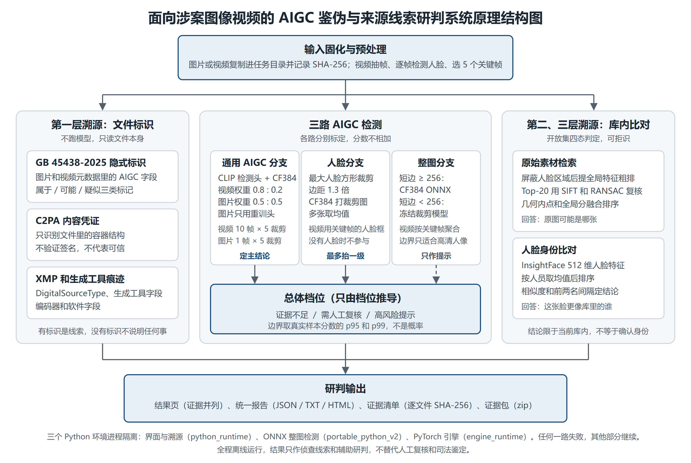

# 面向涉案图像视频的 AIGC 鉴伪与来源线索研判系统

上传一张图片或一段视频，系统分别回答：

- 是不是 AI 生成或换脸？
- 文件自带什么来源标识？
- 原始素材可能是哪张？
- 画面里的人更像库里的谁？

图像、视频检测和库内检索在本机运行；大模型研判与辅助撰写是可选联网能力，需要自行配置服务和密钥。联网时应按配置确认发送范围与服务商费用，未配置或调用失败时使用本地模板。结果只作侦查线索和辅助研判，不替代人工复核和司法鉴定。



## 第三版源码（2026-11-09 同步）

本次同步以第三版交付基线为基础，包含截至 2026-11-08 的云端调用保护、测试入口防自检索、人脸参考入库及界面修复。主系统保留鉴伪、人脸溯源、底图搜索和素材配对。

人脸身份比对只提供图中当前脸的库内相似候选，不能证明 AI 生成或换脸，也不能恢复被替换的原脸或确定制作人。身份相似度不参与当前规则定档。

本次更新不包含团队测试照片、视频、参考图库、嵌入、缓存、结果或接口密钥。test_only 隔离入口只允许向已配置端点发送去标识结构化文字；原图、图库与人脸嵌入留在本机。这不构成服务商零保留承诺。源码中的排除检查不能自动阻止绕过入口的其他程序。

已执行 77 项纯合成回归测试，覆盖参考入库回退、test_only 云端策略和防自检索；这些是软件流程检查，不是鉴伪准确率成绩。本次没有恢复团队批测，也没有重新训练、校准或选择模型、阈值、提示词。

仓库使用 Git LFS 保存默认模型和字体。请按下面步骤克隆，GitHub 的“Download ZIP”不能代替完整的 LFS 获取。默认关闭的 GenD 可选分支权重约 1.216 GB，本次不在 GitHub 重复分发；来源、固定 SHA-256 和手动获取步骤见[GenD 权重获取说明](系统/models/gend-face/DOWNLOAD.md)。默认 `cf384` 分支与模型、阈值、提示词保持不变。11 月 7 日安装包是历史交付，尚未重建为本次源码版本。

## 快速开始

需要 Windows 10 或 11，磁盘空余 15 GB 以上。有 NVIDIA 显卡会快很多，没有也能跑。

```bash
git lfs install
git clone https://github.com/lanjianyu060915-web/aigc-forensics.git D:/aigc-forensics
```

然后依次双击：

1. `搭建环境.bat`：按锁定版本下载运行环境，全程校验 SHA-256。
2. `运行自检.bat`：用内置示例真实跑一遍全部模块。
3. `启动系统.bat`：启动后浏览器自动打开页面。

详细操作见[使用说明](文档/使用说明.md)。

## 能做什么

| 能力 | 做法 | 输出 |
| --- | --- | --- |
| 通用 AIGC 检测 | CLIP 微调模型 + CommunityForensics 融合 | 证据不足 / 需人工复核 / 高风险提示 |
| 人脸检测 | CommunityForensics 打人脸裁剪图 | 最多把总体档位抬一级 |
| 文件标识解析 | GB 45438-2025 隐式标识、C2PA 容器、XMP、生成工具痕迹 | 文件声明了什么 |
| 原始素材检索 | 全局特征粗排 + SIFT/RANSAC 复核，开放集判定 | 库内候选和四态结论 |
| 人脸身份比对 | InsightFace 特征，开放集判定 | 库内候选和四态结论 |
| 证据固定 | 逐文件 SHA-256 清单、证据包、统一报告 | JSON / TXT / HTML / PDF / zip |
| 人工复核 | 追加记录复核人、结论、意见和原报告 SHA-256 | 复核记录、PDF 复核版，保留原版报告 |

新任务自动生成中文 PDF 研判报告。旧任务可点击导出时现场生成；人工复核记录单独追加，导出的复核版不覆盖原版。PDF 生成失败时，TXT、HTML、JSON 报告仍可使用。

分数不是概率。分档边界取真实样本分数的 p95 和 p99，各路分数不相加，总体档位只由档位推导。

## 实测效果

模型、公式和边界冻结后只跑一次的盲测：

| 测试 | AUC | 真实样本误报 | 生成样本检出 |
| --- | ---: | ---: | ---: |
| 图片盲测（1200 张，10 个生成器家族） | 0.886 | 7.8% | 65.7% |
| 图片传播退化（800 张） | 0.812 | 9.2% | 55.8% |
| 视频盲测（146 条，8 个生成器家族） | 0.922 | 15.9% | 76.6% |
| 视频统一转码后（120 条） | 0.917 | 10.0% | 71.7% |

误报和检出指总体档位进入“需人工复核”及以上的比例。视频盲测集有元数据捷径（只看时长 AUC 就有 0.96），转码后那一行更能代表模型对内容的判断。

**换脸是最弱的一环。** 300 张图片的补充盲测（3 种换脸方法）上，人脸分支 AUC 0.663，按总体档位真实图 14.0% 进入复核及以上，换脸图 36.0%。“证据不足”不能排除换脸，换脸线索更多要靠素材检索和身份比对。

完整数据、数据集和测试方法见[测试报告](文档/测试报告.md)，已知局限见[已知问题](系统/KNOWN_ISSUES.md)。

## 文档

| 文档 | 内容 |
| --- | --- |
| [使用说明](文档/使用说明.md) | 安装、操作、怎么读结果 |
| [项目说明书](文档/项目说明书.md) | 这个项目做了哪些事情 |
| [研究报告](文档/研究报告.md) | 问题、设计、关键技术、试验数据 |
| [测试报告](文档/测试报告.md) | 全部测试结果和没有覆盖的部分 |
| [架构说明](文档/架构说明.md) | 系统结构、目录、结果文件、设计取舍 |
| [技术说明](系统/README.md) | 改代码和跑评测要知道的事 |
| [第三方清单](THIRD_PARTY.md) | 模型、数据和软件的来源与许可 |

## 许可

本仓库没有附开源许可证，代码版权保留。模型权重和数据适用各自的上游条款，部分**限非商业研究**（InsightFace 模型、C38 来源链的 R-UDA 等），详见[第三方清单](THIRD_PARTY.md)。身份库和素材库的照片没有肖像或版权授权记录，只用于演示和研究，请勿另作他用。

## 素材配对与案件库升级

当前版本增加前三候选的人工配对对比和案件库检查建索引。展示并排图、对齐滑动图、差异热图及逐脸数值，报告保留库名称、文件数、清单摘要和建库时间；视频只代表首要帧。配对实验未达到启用自动结论的条件，因此不输出伪造类型，不将最大脸身份候选绑定为被修改人脸。原检测档位和素材排序不变。


## 人工复核、逐脸候选和画面标识

- 人工复核可记录类型倾向、依据的素材候选和目标脸，保存候选快照并绑定原报告摘要。复核版 PDF 明示“人工判断，非系统结论”；机器伪造类型仍为空，自动类型结论仍关闭。
- 身份比对保留最大脸的主结果，并为其他脸追加前三候选、原图位置、缩略图和现有开放集判定，包括主脸最多 3 张。每脸独立容错；单脸不重复检索；视频只在首要帧追加逐脸结果。系统不判断哪张脸被改动，逐脸阈值尚未专门验证。
- 文件标识页分别展示元数据声明和离线 OCR 识别到的画面文字。文字线索不改变检测档位；字样可以被添加、裁掉或压缩到无法识别，没识别到不代表不是生成内容，也不核验来源。初始词表尚未在真实工具输出上完整验证，合成字样测试不能当作真实工具识别成绩。

PDF 增加前三候选的配对图、差异热图及逐脸表。对齐失败时暂不能判断是否同源；热图只提示像素变化位置，几何对应不等于身份绑定。逐脸缩略图和结构化结果纳入证据清单。
