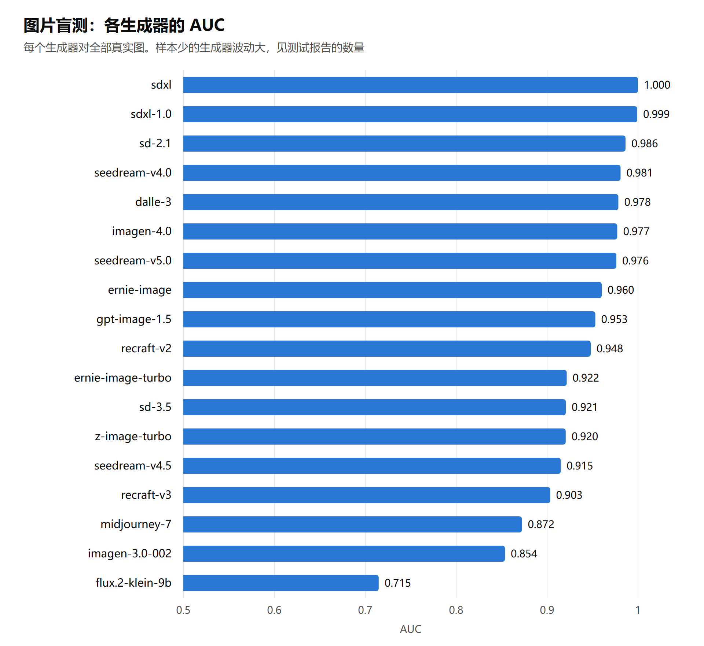
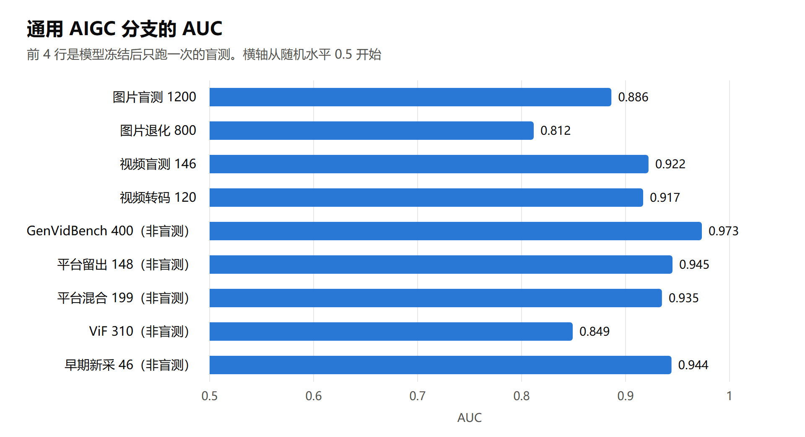
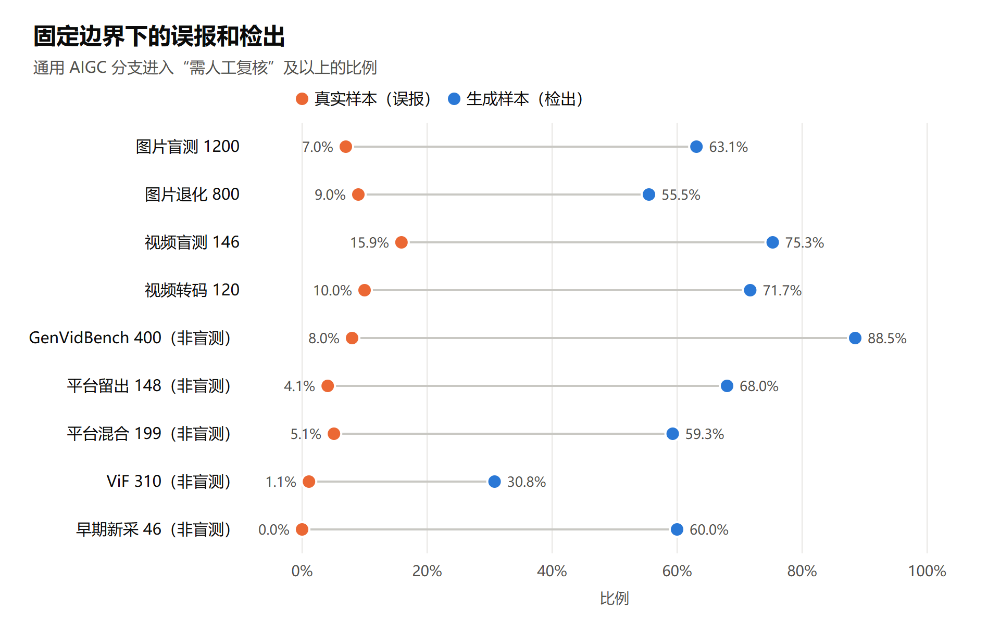
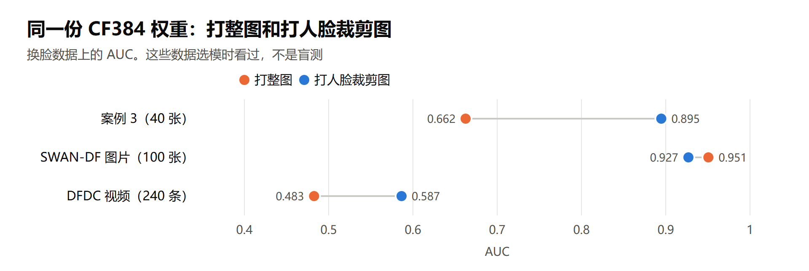

# 测试报告

测试日期：2026-11-04。环境：Windows 11，NVIDIA RTX 5060 Laptop（8 GB），Python 3.12.10。所有数字来自实际运行，汇总和逐样本分数在 `文档/评测/` 下。

## 结论

- **系统能稳定运行。** 自动化回归 518 项和引擎测试 20 项全部通过，一键自检 12 项通过，真实界面用图片、无人脸图和视频走通。从 GitHub 全新克隆后重建环境，同样通过（代码从 GitHub 克隆，LFS 文件因网速慢从本机复制后校验）。
- **通用内容的检测经过了盲测。** 模型和边界冻结后只跑一次：图片 AUC 0.886，视频 AUC 0.922。按总体档位，图片上真实样本 7.8% 进入“需人工复核”及以上，生成样本 65.7%；视频上分别是 15.9% 和 76.6%。
- **换脸是最弱的一环。** 换脸补充盲测（300 张）上，人脸分支 AUC 0.663，通用分支 0.599；按总体档位，真实图 14.0% 进入复核及以上，换脸图 36.0%。换脸线索更多要靠素材检索和身份比对。
- **这是线索工具，不能当结论。** 边界换来源会漂移，部分生成器明显漏检，真实图也会误报。

## 系统能不能跑

| 项目 | 结果 |
| --- | --- |
| 自动化回归 `pytest tests frontend/tests` | 518 项通过 |
| 引擎测试 `pytest engine/tests` | 20 项通过 |
| 一键自检 | 12 项通过 |
| 真实界面（浏览器自动化，真实上传文件） | 高清换脸图、无人脸图、带标识的视频各跑一次综合分析，6 个结果页都打开，没有报错 |
| 全新克隆 | 代码从 GitHub 克隆，双击 `搭建环境.bat` 重建三个 Python 环境（用已有的下载缓存，535 秒），环境校验、回归、引擎测试和自检全部通过。当时网速只有约 0.13 MB/s，LFS 文件是从本机复制的，用 `git lfs fsck` 校验哈希；GitHub 上的 263 个 LFS 文件（2.32 GB）用批量接口逐个确认存在且大小一致 |
| 引擎和原项目推理一致性 | 4 条真实视频分数最大差 2.03e-7 |
| 人脸分支正式流程和试验流程一致性 | 案例 3 全部人脸裁剪分数最大差 9.5e-7 |
| 整图分支和引擎的 CF384 | 同一张图分数差 0.0，确认是同一份权重 |

## 怎么读下面的数字

- **AUC、EER** 只看排序能力，和边界无关。
- **进入复核及以上** 是固定边界下进入“需人工复核”或“高风险提示”的比例：真实样本上是误报，生成样本上是检出。边界取真实样本的 p95 和 p99，名义误报 5% 和 1%。
- **盲测** 指模型、公式、边界都定下来以后，对没见过的数据只跑一次，跑完没有再调。选模时看过的集合都标了“非盲测”。

## 通用 AIGC 分支：图片盲测

数据集说明见 [图片评测集](评测/图片评测-20261104/数据集说明.md)：OpenFake 的 2000 张（10 个生成器家族），另有 800 张传播退化图。两侧统一处理成 512×512 JPEG，元数据捷径基线 AUC 从 0.969 降到 0.513。

| 划分 | 样本 | AUC | EER | 真实：复核及以上 / 高风险 | 生成：复核及以上 / 高风险 |
| --- | ---: | ---: | ---: | ---: | ---: |
| 校准（非盲测） | 800 | 0.909 | 18.0% | 5.2% / 1.2% | 65.7% / 56.4% |
| test（盲测） | 1200 | 0.886 | 21.8% | 7.0% / 2.5% | 63.1% / 52.9% |
| test 里被退化的 400 张母图（对照） | 400 | 0.886 | 22.5% | 6.5% / 1.0% | 62.0% / 55.5% |
| 退化：JPEG q75 | 400 | 0.866 | 23.5% | 8.0% / 2.0% | 65.0% / 51.0% |
| 退化：缩小 50% + JPEG q85 | 400 | 0.752 | 33.0% | 10.0% / 2.5% | 46.0% / 34.5% |

- 校准划分用来定公式和边界，test 上 AUC 比它低 0.022，真实样本误报从 5.2% 升到 7.0%，属于正常的乐观偏差。
- 公式 `0.5 × 重训头 + 0.5 × CF384` 是在校准划分上定的。原来的融合公式在校准划分上 AUC 只有 0.865，因为 C38 原头在图片上基本失效（AUC 0.59）。
- 缩小 50% 再压缩后掉得最明显（AUC 0.752）。转发多次的图片要预期结果变差。

各生成器（test，每个生成器对全部真实图）：

| 生成器 | 样本 | AUC | 复核及以上 | 高风险 |
| --- | ---: | ---: | ---: | ---: |
| sdxl | 20 | 1.000 | 100.0% | 100.0% |
| sdxl-1.0 | 10 | 0.999 | 100.0% | 100.0% |
| sd-2.1 | 13 | 0.986 | 84.6% | 84.6% |
| seedream-v4.0 | 10 | 0.981 | 90.0% | 90.0% |
| dalle-3 | 15 | 0.978 | 86.7% | 73.3% |
| imagen-4.0 | 6 | 0.977 | 100.0% | 66.7% |
| seedream-v5.0 | 7 | 0.976 | 100.0% | 57.1% |
| ernie-image | 12 | 0.960 | 83.3% | 83.3% |
| gpt-image-1.5 | 96 | 0.953 | 84.4% | 72.9% |
| recraft-v2 | 8 | 0.948 | 75.0% | 75.0% |
| ernie-image-turbo | 24 | 0.922 | 66.7% | 66.7% |
| sd-3.5 | 18 | 0.921 | 66.7% | 61.1% |
| z-image-turbo | 108 | 0.920 | 71.3% | 59.3% |
| seedream-v4.5 | 13 | 0.915 | 76.9% | 69.2% |
| recraft-v3 | 35 | 0.903 | 68.6% | 45.7% |
| midjourney-7 | 72 | 0.872 | 55.6% | 44.4% |
| imagen-3.0-002 | 14 | 0.854 | 42.9% | 28.6% |
| flux.2-klein-9b | 120 | 0.715 | 17.5% | 9.2% |

- **最弱的是 flux.2-klein-9b**：AUC 0.715，只有 17.5% 进入复核及以上。这个家族占生成侧 20%，整体检出率被它拉低很多。
- 样本少的生成器（15 张以下）只能看个大概。

真实来源（test）：

| 来源 | 样本 | 复核及以上 | 高风险 |
| --- | ---: | ---: | ---: |
| DOCCI | 200 | 9.0% | 3.5% |
| IMAGENET | 200 | 2.0% | 0.0% |
| PEXELS | 199 | 10.1% | 4.0% |

**内容构成有偏差。** 带人脸的图在真实侧只占约 13%，生成侧约 51%。所以分开看：有人脸的样本 AUC 0.781，没有人脸的 0.903。带人脸的内容更难。

## 通用 AIGC 分支：视频盲测

数据集说明见 [视频盲测集](评测/视频盲测-20261104/数据集说明.md)：8 个生成器家族，全部是选模时没见过的文件（按 SHA-256 比对）。

**这个集合有明显的元数据捷径：只看时长和文件大小，AUC 就有 0.960。** 模型只看抽取的帧，用不到时长，但分辨率和上游转码的差异可能被间接学到。所以同时列统一转码（H.264 CRF28、720p）后的结果，它更能代表模型对内容本身的判断。

| 划分 | 样本 | AUC | EER | 真实：复核及以上 / 高风险 | 生成：复核及以上 / 高风险 |
| --- | ---: | ---: | ---: | ---: | ---: |
| 校准（并入边界，非盲测） | 63 | 0.925 | 14.7% | 13.8% / 0.0% | 85.3% / 67.6% |
| test（盲测） | 146 | 0.922 | 19.5% | 15.9% / 4.3% | 75.3% / 62.3% |
| test 里被转码的 120 条原片（对照） | 120 | 0.925 | 18.3% | 15.0% / 5.0% | 76.7% / 61.7% |
| 统一转码后（盲测） | 120 | 0.917 | 18.3% | 10.0% / 3.3% | 71.7% / 53.3% |

各生成器（test，样本很少，只能看个大概）：

| 生成器 | 样本 | AUC | 复核及以上 | 高风险 |
| --- | ---: | ---: | ---: | ---: |
| Pika | 10 | 0.983 | 100.0% | 80.0% |
| Runway | 10 | 0.957 | 80.0% | 80.0% |
| Hunyuan | 10 | 0.948 | 90.0% | 70.0% |
| Wan | 11 | 0.930 | 81.8% | 63.6% |
| Luma | 11 | 0.916 | 72.7% | 63.6% |
| Sora | 9 | 0.905 | 66.7% | 55.6% |
| Veo | 11 | 0.889 | 63.6% | 45.5% |
| Seedance | 5 | 0.780 | 20.0% | 20.0% |

## 通用 AIGC 分支：选模时看过的视频集合（非盲测）

这些集合用来选模型，真实样本也参与了定边界，数字偏乐观，只作参考。

| 集合 | 样本 | AUC | EER | 真实：复核及以上 / 高风险 | 生成：复核及以上 / 高风险 |
| --- | ---: | ---: | ---: | ---: | ---: |
| 平台留出 148 | 148 | 0.945 | 11.0% | 4.1% / 2.7% | 68.0% / 54.7% |
| 平台混合 199 | 199 | 0.935 | 14.4% | 5.1% / 1.7% | 59.3% / 32.1% |
| GenVidBench 400 | 400 | 0.973 | 11.0% | 8.0% / 1.5% | 88.5% / 76.5% |
| ViF 310 | 310 | 0.849 | 23.1% | 1.1% / 1.1% | 30.8% / 21.3% |
| 早期新采 46 | 46 | 0.944 | 10.0% | 0.0% / 0.0% | 60.0% / 35.0% |

## 换脸：补充盲测

数据集说明见 [换脸盲测集](评测/换脸盲测-20261104/数据集说明.md)：3 种换脸方法，150 对真实和换脸图片，采集时没有运行任何模型。看成绩之前定好了规则：模型和边界不动，原始文件是主结果，统一编码副本只作对照，只跑一次。因为人物身份分组不完整，这是带限制的补充盲测。

| 输入 | 通用分支 AUC | CF384 打整图 AUC | CF384 打人脸裁剪图 AUC | 真实：通用 / 人脸 / 总体 | 换脸：通用 / 人脸 / 总体 |
| --- | ---: | ---: | ---: | ---: | ---: |
| 原始文件（主结果） | 0.599 | 0.612 | 0.663 | 10.7% / 6.7% / 14.0% | 20.7% / 25.3% / 36.0% |
| 统一编码（对照） | 0.642 | 0.677 | 0.658 | 3.3% / 8.7% / 11.3% | 9.3% / 30.7% / 35.3% |

各换脸方法（原始文件，真实图只取同一来源的）：

| 方法 | 通用分支 AUC | 人脸裁剪 AUC | 真实：总体复核及以上 | 换脸：总体复核及以上 |
| --- | ---: | ---: | ---: | ---: |
| InfoSwap | 0.575 | 0.642 | 18.0% | 38.0% |
| InsightFace | 0.604 | 0.730 | 6.0% | 30.0% |
| SimSwap | 0.643 | 0.648 | 18.0% | 40.0% |

- **人脸分支是有用的，但很有限。** 只看通用分支，换脸图 20.7% 进入复核及以上；加上人脸分支到 36.0%，代价是真实图从 10.7% 升到 14.0%。
- **大约三分之二的换脸图仍然漏掉。** “证据不足”不能排除换脸。
- 这个成绩比选模时看过的高清换脸（案例 3，AUC 0.895）低很多，说明之前的数字偏乐观。

## 换脸：选模时看过的数据（非盲测）

这些数据都是选模和定边界时看过的，数字偏乐观。

| 数据 | 样本 | 通用分支 AUC | CF384 打整图 AUC | CF384 打人脸裁剪图 AUC |
| --- | ---: | ---: | ---: | ---: |
| 案例 3 | 40 | 0.672 | 0.662 | 0.895 |
| SWAN-DF 图片 | 100 | 0.844 | 0.951 | 0.927 |
| SWAN-DF 视频 | 13 | 1.000 | 1.000 | 1.000 |
| DFDC 视频 | 240 | 0.541 | 0.483 | 0.587 |
| FF 112 像素裁剪 | 150 | 0.540 | 0.449 | 不适用 |

固定边界下进入复核及以上的比例：

| 数据 | 真实：通用 / 人脸 / 总体 | 换脸：通用 / 人脸 / 总体 |
| --- | ---: | ---: |
| 案例 3 | 70.0% / 35.0% / 70.0% | 100.0% / 95.0% / 100.0% |
| SWAN-DF 图片 | 0.0% / 0.0% / 0.0% | 15.0% / 0.0% / 15.0% |
| SWAN-DF 视频 | 0.0% / 0.0% / 0.0% | 0.0% / 0.0% / 0.0% |
| DFDC 视频 | 0.0% / 10.0% / 10.0% | 0.0% / 12.5% / 12.5% |

怎么读：

- **高清换脸（案例 3）：** 打人脸裁剪图明显好于打整图（AUC 0.895 对 0.662）。但这批原图的误报也很高，真实图 70.0% 进入复核及以上。
- **SWAN-DF：** 排序很好（AUC 0.927），但分数整体偏低，通用边界下几乎抓不到。这说明换脸分数的绝对水平跨数据集差别很大。
- **DFDC：** 低清视频上基本分不开（AUC 0.587）。真假都有约一成进入复核。
- **112 像素的小裁剪：** 人脸分支不适用，通用分支 AUC 0.540。

## 总体档位规则的效果

总体档位以通用分支为主，人脸分支最多抬一级。下表是同一批样本上只看通用分支和按总体规则的对比（进入复核及以上）：

| 数据 | 真实：通用 → 总体 | 生成：通用 → 总体 |
| --- | ---: | ---: |
| 图片盲测 test | 7.0% → 7.8% | 63.1% → 65.7% |
| 图片退化 | 9.0% → 9.2% | 55.5% → 55.8% |
| 视频盲测 test | 15.9% → 15.9% | 75.3% → 76.6% |
| 视频统一转码 | 10.0% → 10.0% | 71.7% → 71.7% |
| 平台混合 199（非盲测） | 5.1% → 9.3% | 59.3% → 65.4% |
| 案例 3（非盲测） | 70.0% → 70.0% | 100.0% → 100.0% |
| DFDC（非盲测） | 0.0% → 10.0% | 0.0% → 12.5% |

人脸分支增加的检出不多，误报也只多一点。它的主要价值在高清换脸这类通用分支看不出来的情况。

## 为什么整图分支只作提示

整图分支的边界是在 SWAN-DF 的高清人像上定的（真实图 p95、p99），换到普通内容就失效了：

| 数据 | 真实样本进入复核及以上 | 其中高风险 |
| --- | ---: | ---: |
| 图片盲测 test（真实图 599 张） | 50.6% | 45.4% |
| DFDC 真实视频 | 69.2% | 41.7% |
| 平台留出 148 | 79.5% | 79.5% |
| 平台混合 199 | 77.1% | 70.3% |
| GenVidBench 400 | 87.0% | 81.0% |
| ViF 310 | 66.3% | 62.9% |
| 早期新采 46 | 76.9% | 73.1% |
| SWAN-DF 图片（它的标定来源） | 2.5% | 1.2% |

如果让它参与总体结论，大多数真实内容都会被标高风险，所以结果页仍然展示它，但不影响总体档位。视频集合的数字是用同一份 CF 分数按它的边界换算的，只看量级。

## 文件标识解析

| 数据 | 文件数 | 结果 |
| --- | ---: | --- |
| 人工收集的真假视频 | 1007 | 2 条 Label 1、7 条 Label 2、1 条工具痕迹，这 10 条都是生成视频；其余 997 条没有标识；C2PA 0 条 |
| 素材库 | 203 | 全部没有标识 |
| 公开的真实视频 | 35 | 全部没有标识 |

- 没有误报，但命中率很低，1007 条里只有 10 条。平台转码和转发基本都会丢掉标识。所以它的定位是“命中了是强线索”。
- 解析器有 156 项测试，覆盖图片和视频的主要容器。C2PA 只检测结构，不验证签名。

## 素材检索

原来的开放集阈值是在人脸素材上定的。这次用通用图片验证：400 张图建库，查询是库内图的退化版本（应找到）和库外图（应拒绝）。

| 查询 | 条数 | 高可信候选 | 证据不足 | 库中未发现可靠候选 |
| --- | ---: | ---: | ---: | ---: |
| 库内图的退化版本（应找到） | 100 | 100 | 0 | 0 |
| 库外图（应拒绝） | 100 | 0 | 7 | 93 |

两组的全局分完全分开（库内最低 0.929，库外最高 0.716），原来的阈值（0.875 和 0.641）不用改。7 条“证据不足”都是库外的真实图，没有误判成高可信。

这里的查询只做了压缩和缩小，没有测裁剪和大幅改动。换脸改动大时全局分会下降：之前的案例 3 里 20 组第一候选命中 19 组，但只有 1 组到高可信，18 组是证据不足，所以要看第一候选和人工并排对比，不能只看结论。

## 身份比对

算法和阈值沿用升级 2.0 的结果，这次没有改动：库外 10/10 拒识，库内 12/12 命中。案例 3 的 20 组里，第一候选命中 17 组。

## 耗时

在 RTX 5060 笔记本上，通过真实界面测的。通用分支走显卡，其他模块走 CPU。

| 输入 | 总耗时 | 鉴伪 | 身份 | 素材 |
| --- | ---: | ---: | ---: | ---: |
| 高清图片（2000×3554，有人脸） | 24–66 秒 | 2–8 秒 | 9–40 秒 | 6–17 秒 |
| 6 秒视频，没有人脸 | 31 秒 | 13 秒 | 0.2 秒 | 8 秒 |
| 10 秒视频，有人脸 | 139 秒 | 20 秒 | 94 秒 | 10 秒 |
| 全新环境第一次分析（要建索引和缓存） | 570 秒 | 6 秒 | 425 秒 | 95 秒 |

身份比对最慢，波动也最大：同一张图有时 9 秒，有时 40 秒。试过调线程数和 denormal 归零，都没有改善，看起来和机器当时的状态有关。

第一次使用要建身份索引和素材特征缓存，只做一次。没有显卡时通用分支走 CPU，图片约 6 秒，10 秒的视频约 1 分钟，分数和显卡上一致；模型加载要 40 多秒，常驻服务只加载一次。

## 报告和证据导出

做过一次独立验收：用合成结果走报告和证据包模块，共 28 项，24 项通过、3 项失败、1 项跳过。

- **3 项失败是同一个缺陷，已修复：** 清单为空或条目缺少 SHA-256 时，完整性校验仍然提示“全部一致”。现在缺哈希的条目记为问题，空清单提示没有完成校验，并加了回归测试。修复后在 26 个真实任务上复核，没有误报。
- **1 项跳过：** 证据包不跟随符号链接的测试，因为 Windows 权限不足没有跑。
- 这次验收用的是合成数据，没有经过真实浏览器和模型。

## 没有覆盖的部分

- **没有在第二台电脑上测过。** 全新克隆是同一台机器换目录重建环境，不能完全代表一台干净的电脑。
- **没有用真实案件材料测过。** 所有数据都是公开数据集或人工收集的样本。
- **换脸盲测规模小、有限制。** 只有 300 张图片，人物身份分组不完整，没有视频。
- **视频盲测规模小。** test 只有 146 条，单个生成器 5–11 条，而且有元数据捷径。
- **图片盲测内容有偏差。** 来自一个数据集的两个分片，统一处理成 512×512，生成侧人物和插画更多。
- **没有做长时间连续运行测试。**
- 身份比对和素材检索在换脸案例上的结果沿用之前的记录，这次只重跑了素材检索的通用图片部分。
