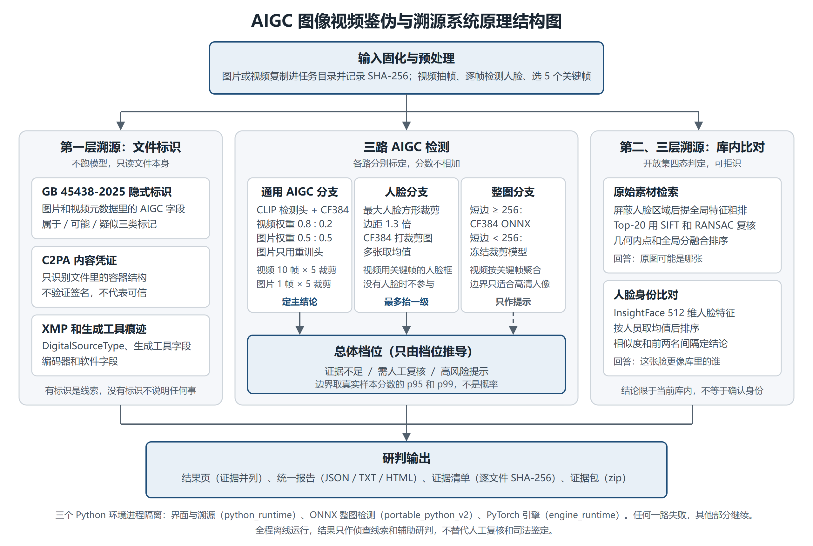
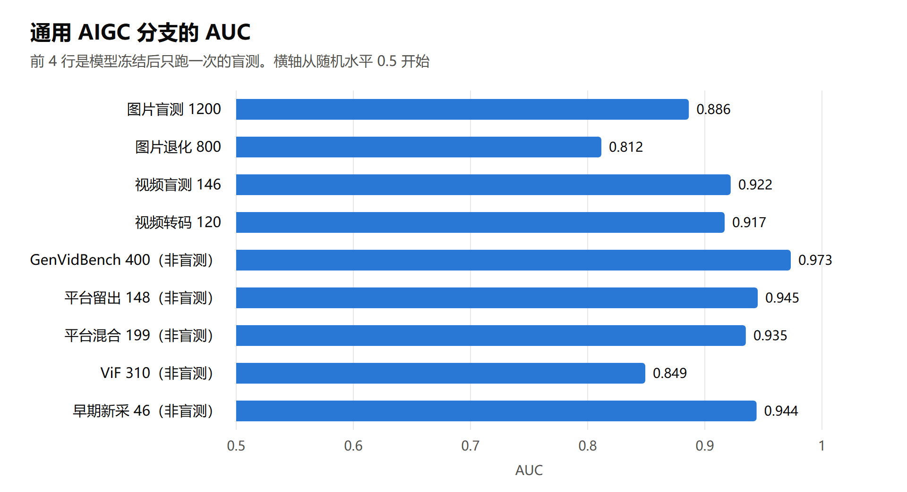
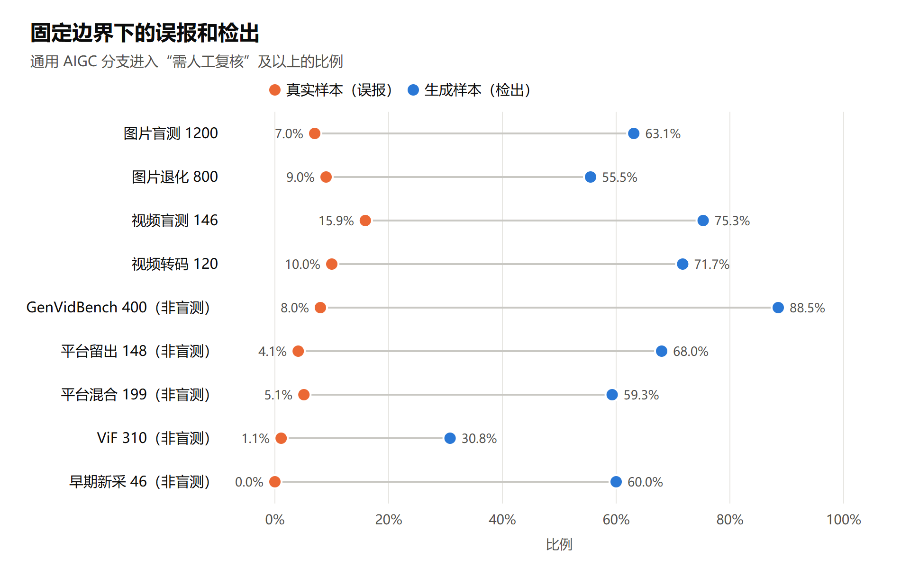
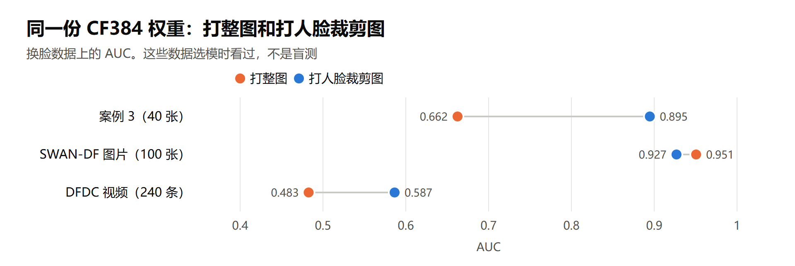

# 面向图片和视频的 AIGC 鉴伪与溯源系统研究报告

## 一、要解决的问题

生成式 AI 让伪造图片和视频的门槛降到很低。假视频、换脸图、合成证据图进入案件和舆情后，办案人员面对一份可疑材料，通常要回答三个问题：

1. 它是不是 AI 生成或换脸的？
2. 它从哪里来？文件有没有自带生成标识，原始素材是哪张，画面里的人可能是谁？
3. 这些判断能不能复核和留痕？

现有工具解决这三个问题时有明显短板：

- **检测器换一批来源就失效。** 我们实测，同一个模型在不同来源上的表现差别很大，固定阈值的误报率也会大幅漂移（见第四节）。把一个分数直接报成“真假”或“概率”，在实战中不可靠。
- **只判真假，不给来源线索。** 判断“可能是假的”之后，办案还要找原图、找当事人，这部分通常靠人工。
- **结果不能留痕。** 在线检测服务要上传材料，涉案内容不适合外传，结果也难以固定。

本项目把团队已有的换脸鉴伪系统和视频检测项目合并，做成一个离线运行的桌面系统：上传一张图或一段视频，给出分档的检测结论、三层来源线索和可校验的证据包。系统定位是**侦查线索和辅助研判工具**，不替代人工复核和司法鉴定。

## 二、系统设计

整体是**一个产品、三路检测、三层溯源**。

**三路检测**回答“是不是生成或换脸”：

| 分支 | 输入 | 模型 | 在总体结论里的作用 |
| --- | --- | --- | --- |
| 通用 AIGC 分支 | 视频 10 帧、图片 1 帧，各 5 个裁剪 | CLIP 微调模型的多个检测头 + CommunityForensics（CF384） | 定主结论 |
| 人脸分支 | 最大人脸的方形裁剪图 | CF384 | 提示风险时最多把档位抬一级 |
| 整图分支 | 整张图或关键帧 | CF384 的 ONNX 版，小图走冻结裁剪模型 | 只作提示，不影响档位 |

**三层溯源**回答“从哪里来”：

| 层次 | 做法 | 回答的问题 |
| --- | --- | --- |
| 文件标识 | 解析 GB 45438-2025 隐式标识、C2PA 容器结构、XMP DigitalSourceType 和生成工具痕迹，不跑模型 | 文件自己声明了什么 |
| 素材检索 | 屏蔽人脸后提全局特征粗排，前 20 名用 SIFT 和 RANSAC 几何复核，开放集判定 | 原图可能是素材库里哪张 |
| 身份比对 | InsightFace 512 维人脸特征，按人员取均值排序，开放集判定 | 这张脸更像身份库里的谁 |

结果页把这些证据并列展示，**不合成一个总概率**。每个任务生成统一报告（JSON、TXT、HTML）和逐文件 SHA-256 证据清单，可以打包移交，事后可重新校验。

工程上，三个 Python 环境（界面和溯源、ONNX 检测、PyTorch 引擎）由进程隔离，模型常驻服务失败时自动回退到子进程；任何一路失败都只影响这一路。全程离线，数据不出本机。

## 三、关键技术和创新点

### 1. 用真实样本分位点分档，不给概率

检测模型输出的原始分数没有校准，不同模型、不同来源上含义都不一样。我们不把分数报成概率，而是用**真实样本分数的分布**定边界：高于 p95 进“需人工复核”，高于 p99 进“高风险提示”，多个来源按来源等权。档位的含义很明确：这个分数在真实样本里有多少见。

### 2. 总体结论只由档位推导

各路分数性质不同，不能相加。我们试过跨数据集加权融合，外部集 AUC 从 0.898 掉到 0.439。所以总体档位用确定性规则从各路档位推导：

- 通用分支定主结论。
- 人脸分支提示风险时，“证据不足”抬到“需人工复核”；“需人工复核”且人脸分支为高风险时，抬到“高风险提示”。
- 整图分支不影响档位。它的边界只在高清人像上标定过，普通真实视频里有 63–81% 会触发高风险，如果让它参与，结论就没有意义了。
- 通用分支不可用时，单路最高只到“需人工复核”。

这条规则的取舍都有实测依据，见第四节。

### 3. 多来源、多视角融合的通用检测

通用分支的模型选择过程全程留有记录：

- 视频上比较了裁剪数、帧数、聚合方式和融合权重。多裁剪的收益集中在高分辨率视频，说明原来只看中心裁剪覆盖面太小。
- 重训检测头在平台视频上明显变好，但只用平台数据训练会丢掉对生成器内容的检测力。最终把原头和 3 个重训头平均，再和 CF384 融合：`0.8 × [0.5 × 原头 + 0.5 × 3 个重训头均值] + 0.2 × CF384`。
- 图片上发现原头基本失效（校准集 AUC 0.59），改用 `0.5 × 重训头 + 0.5 × CF384`，AUC 升到 0.91，不需要新训练。

### 4. 人脸裁剪分支

换脸只改人脸区域，整图检测容易被背景稀释。我们用同一份 CF384 权重改打人脸裁剪图：在选模用的高清换脸上明显好于整图（案例 3：0.89 对 0.66），补充盲测上也好一些（0.663 对 0.612），而且不需要新模型。视频直接复用抽帧时记录的人脸框，几乎不增加耗时。

### 5. 文件标识解析

GB 45438-2025 自 2025 年 9 月起施行，要求生成内容带隐式标识。系统按标准附录解析图片和视频元数据里的标识，区分“属于、可能、疑似”三类，同时检测 C2PA 容器和生成工具痕迹。这部分不依赖模型，命中时是很强的线索，也如实说明了局限：标识可以伪造，转码和截图会丢失，没有标识不说明任何事。

### 6. 开放集判定

素材和身份检索总能返回一个“最相似”的结果，库里没有时也一样。系统在排序之上加了开放集判定，用独立校准集定的阈值，把结果分成高可信候选、证据不足、库中未发现可靠候选、本次无法比对四种状态，避免把最相似当成已找到。

## 四、试验数据

所有数字都来自实际运行，逐样本结果和汇总放在 `文档/评测/` 下。

### 1. 数据

| 数据 | 规模 | 用途 | 是否盲测 |
| --- | ---: | --- | --- |
| 公开图片集（OpenFake，10 个生成器家族） | 校准 800 张，测试 1200 张，退化 800 张 | 定图片公式和边界，然后盲测一次 | 测试和退化部分是 |
| 公开新视频（8 个生成器家族） | 校准 63 条，测试 146 条，转码 120 条 | 边界，然后盲测一次 | 测试和转码部分是 |
| 平台、人工收集和公开基准视频（5 个集合） | 1103 条 | 选模型、定视频边界 | 否 |
| 公开换脸图片（DGM4、DeepFakeFace，3 种方法） | 150 对 | 人脸分支的补充盲测 | 是，有限制 |
| 换脸数据（DFDC、SWAN-DF、案例 3、FF 裁剪） | 543 个样本 | 选模、定人脸分支边界 | 否 |

数据采集时没有看任何模型分数。为防止元数据捷径，图片集两侧统一处理后，只看宽高、格式、大小的基线 AUC 从 0.969 降到 0.513。视频集保留了发布原始字节，这个基线 AUC 有 0.960（主要靠时长），所以同时报告统一转码后的结果。

### 2. 通用内容检测

| 测试 | 样本 | AUC | EER | 真实：复核及以上 / 高风险 | 生成：复核及以上 / 高风险 |
| --- | ---: | ---: | ---: | ---: | ---: |
| 图片 test | 1200 | 0.886 | 21.8% | 7.0% / 2.5% | 63.1% / 52.9% |
| 图片退化：JPEG q75 | 400 | 0.866 | 23.5% | 8.0% / 2.0% | 65.0% / 51.0% |
| 图片退化：缩小 50% + JPEG q85 | 400 | 0.752 | 33.0% | 10.0% / 2.5% | 46.0% / 34.5% |
| 视频 test | 146 | 0.922 | 19.5% | 15.9% / 4.3% | 75.3% / 62.3% |
| 视频统一转码后 | 120 | 0.917 | 18.3% | 10.0% / 3.3% | 71.7% / 53.3% |

图片上各生成器差别很大：SDXL、Seedream、DALL-E 3、GPT-Image 等 AUC 在 0.95 以上，最弱的 flux.2-klein-9b 只有 0.715。传播退化会降低效果，图片缩小 50% 再压缩后 AUC 降到 0.752。

### 3. 换脸检测

| 数据 | 样本 | 通用分支 AUC | CF384 打整图 AUC | CF384 打人脸裁剪图 AUC |
| --- | ---: | ---: | ---: | ---: |
| 案例 3 | 40 | 0.672 | 0.662 | 0.895 |
| SWAN-DF 图片 | 100 | 0.844 | 0.951 | 0.927 |
| SWAN-DF 视频 | 13 | 1.000 | 1.000 | 1.000 |
| DFDC 视频 | 240 | 0.541 | 0.483 | 0.587 |
| FF 112 像素裁剪 | 150 | 0.540 | 0.449 | 不适用 |

上表的数据选模时都看过，结果偏乐观。人脸裁剪在高清换脸上明显提升，但 DFDC 这类低清视频上接近随机，分数的绝对水平跨数据集差别也很大。

之后用 300 张新采集的换脸图片做了一次补充盲测（3 种方法，模型和边界不动，只跑一次）：

| 输入 | 通用分支 AUC | CF384 打整图 AUC | CF384 打人脸裁剪图 AUC | 真实：通用 / 人脸 / 总体 | 换脸：通用 / 人脸 / 总体 |
| --- | ---: | ---: | ---: | ---: | ---: |
| 原始文件（主结果） | 0.599 | 0.612 | 0.663 | 10.7% / 6.7% / 14.0% | 20.7% / 25.3% / 36.0% |
| 统一编码（对照） | 0.642 | 0.677 | 0.658 | 3.3% / 8.7% / 11.3% | 9.3% / 30.7% / 35.3% |

结论很明确：**换脸是系统最弱的一环。** 人脸分支 AUC 0.663，比通用分支好，能把换脸图的检出从 20.7% 提到 36.0%，但大约三分之二的换脸图仍然漏掉。所以换脸必须靠素材检索和身份比对配合，“证据不足”不能排除换脸。这组盲测的人物身份分组不完整，规模也不大，只能算补充证据。

### 4. 总体规则

下表对比只看通用分支和按总体规则（进入复核及以上的比例）：

| 数据 | 真实：通用 → 总体 | 生成或换脸：通用 → 总体 |
| --- | ---: | ---: |
| 图片盲测 test | 7.0% → 7.8% | 63.1% → 65.7% |
| 图片退化 | 9.0% → 9.2% | 55.5% → 55.8% |
| 视频盲测 test | 15.9% → 15.9% | 75.3% → 76.6% |
| 视频统一转码 | 10.0% → 10.0% | 71.7% → 71.7% |
| 平台混合 199（非盲测） | 5.1% → 9.3% | 59.3% → 65.4% |
| 案例 3（非盲测） | 70.0% → 70.0% | 100.0% → 100.0% |
| DFDC（非盲测） | 0.0% → 10.0% | 0.0% → 12.5% |

整图分支如果参与结论，代价很大：它的边界在高清人像上标定，普通真实视频有 63–81% 会进高风险，图片盲测的真实图有 50.6% 进入复核及以上。所以只作提示。

### 5. 溯源

- **文件标识：** 1007 条人工收集的真假视频里，9 条带 GB 45438 隐式标识，1 条有工具痕迹，全部是生成视频，没有误报；素材库 203 张和公开真实视频 35 条全部没有标识。命中率低，因为转码和转发会丢掉标识。
- **素材检索：** 通用图片上，库内图的退化版本 100 条全部找到并判高可信，库外图 100 条里 93 条拒绝、7 条判证据不足，没有误判成高可信，原阈值不用改。换脸改动大时全局分会下降：案例 3 的 20 组里第一候选命中 19 组，但多数只到证据不足。
- **身份比对：** 开放集判定库外 10/10 拒识、库内 12/12 命中；案例 3 的 20 组里第一候选命中 17 组。

### 6. 工程

自动化回归 518 项和引擎测试 20 项全部通过，真实界面用图片和视频走通。代码从 GitHub 克隆，双击 `搭建环境.bat` 重建三个 Python 环境（用已有的下载缓存，535 秒），环境校验、回归、引擎测试和自检全部通过。当时网速只有约 0.13 MB/s，LFS 文件是从本机复制的，用 `git lfs fsck` 校验哈希；GitHub 上的 263 个 LFS 文件（2.32 GB）用批量接口逐个确认存在且大小一致。完整结果见 [测试报告](测试报告.md)。

## 五、局限

如实说明系统做不到什么：

- **换脸检测弱。** 补充盲测上人脸分支 AUC 只有 0.663，大约三分之二的换脸图进不了复核。“证据不足”不能排除换脸。
- **部分生成器漏检明显。** 比如 flux.2-klein-9b 只有 17.5% 进入复核及以上。没训练过的新生成器可能更差。
- **边界会随来源漂移。** 名义误报 5%，盲测里实际是 7.0%（图片）。换一批来源、经过强压缩或翻拍后还可能更高。
- **评测有局限。** 图片集统一处理成 512×512，内容有偏差；视频盲测规模小，有元数据捷径；换脸盲测人物身份分组不完整，没有视频；没有用真实案件材料测过。
- **生成器归因没有做。** 粗测同一数据集内 19 类准确率 37%，换一个数据集只有 6.5%，不足以作为结论。
- **标识不验签。** C2PA 只检测结构，GB 45438 标识可以伪造。
- **库外的人和图找不到。** 素材和身份只在当前库内比较。
- **部分权重和数据限非商业研究。** 见仓库的第三方清单。

## 六、使用流程和应用场景

1. 办案人员把涉案图片或视频拖进系统，系统固化文件并记录 SHA-256。
2. 点“一键综合分析”，图片约 1 分钟，没有人脸的短视频约 30 秒，有人脸的视频约 2–3 分钟。
3. 先看研判总览：总体档位、文件标识、素材和身份的结论。
4. 按需要看各页证据：逐帧分数、人脸裁剪图、素材匹配连线图、身份比对图。
5. 导出报告或证据包，移交复核。

典型场景：

- **涉案图片核查。** 判断图片是否生成，同时在素材库里找原图，发现换脸时可以把原图和换脸图并列。
- **网传视频研判。** 先读文件标识，再看通用分支和逐帧分数，分数高的时刻人工重点复核。
- **批量筛查。** 一次最多 100 张图片，结果汇总成表导出，优先复核高风险的部分。

## 七、结论和下一步

系统已经能稳定运行，并把检测、溯源和证据固定串成一个流程。通用内容的检测在盲测上 AUC 为 0.886（图片）和 0.922（视频）。换脸是目前最弱的一环，需要溯源层配合。

下一步：

- 用同源的真实视频继续校准边界，降低来源漂移的影响。
- 加强低清视频上的换脸检测。
- 和实战单位的真实样本对接，检验实际效果。
